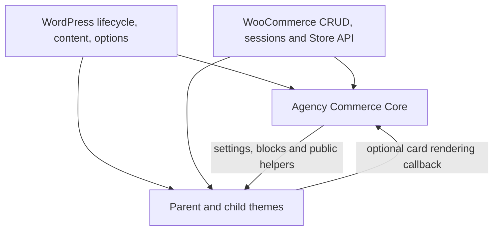

# Architecture overview

Core initializes on `plugins_loaded` through `agency-commerce-core.php` and `includes/Plugin.php`. It can load its classes through a Composer autoloader or its bundled namespace loader. Settings cover defaults and persisted overrides. Separate services register presets, products, checkout controls, homepage blocks, and the recently viewed route. WooCommerce processing stays in WooCommerce, including HPOS order storage.

The theme loads settings fallback, setup, navigation, catalogue, assets, and WooCommerce adapters from `inc/`. Template hooks and layout helpers bridge standard WooCommerce rendering to theme components. The core's optional card renderer check has a fallback if the parent theme is inactive. The dependency is a rendering seam, with settings and checkout behavior owned by the plugin.
